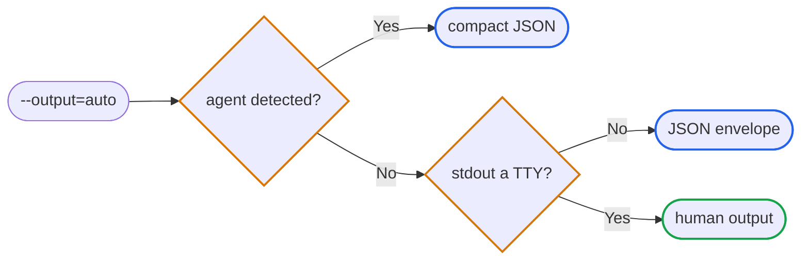

# :outbox_tray: Output & exit codes

`jira` has one global output selector, `--output`, with four values. There is
no short form — one spelling, so a script and its reader never disagree about
what `-o` meant.

```sh
jira version --output=auto
jira version --output=human
jira version --output=json
jira version --output=compact
```

## Modes

| Mode | Behavior |
|------|----------|
| `auto` | Detected agent → compact; other non-TTY → JSON envelope; interactive terminal → human. |
| `human` | Force the human surface regardless of TTY state. |
| `json` | Full envelope on stdout with `ok`, `meta`, `data`, `errors[]`, `warnings[]`. |
| `compact` | Bare `data` on success; the full envelope on failure. |

Agent detection follows the cross-tool `AGENT` / `AI_AGENT` convention first —
a falsy value there is an explicit opt-out — then per-vendor marker variables
such as `CLAUDECODE`. An agent beats a TTY: a coding agent running in a real
terminal still gets compact.



`compact` is the lean view for agents: on success it emits the `data` payload
and nothing else. It does **not** strip nulls. Whether a field is `null` or
absent is decided per field by the command that owns it, so an explicit null
means something and the renderer must not erase it.

On failure `compact` emits the full envelope, the same as `json` would. Bare
data on a failure would drop `ok`, `errors[]`, and `meta.exit_code` — exactly
the fields that tell an agent something went wrong.

Both machine modes write one newline-terminated line of JSON to **stdout**, on
success and failure alike, so a consumer parses one stream regardless of
outcome. The human diagnostic — the `❌` message and its `💡` hint — always
goes to **stderr**, in every mode, so it can never break the parse. In
`--output=human` a failure writes nothing at all to stdout.

## Built-in jq

`--jq EXPR` runs a [jq](https://jqlang.org) expression over the emitted JSON
in-process (gojq engine — no external `jq` required). String results print
raw, `jq -r` style; every other value prints as jq-flavored JSON, one result
per line.

```sh
jira version --jq '.data.go_version'
jira version --jq '{go: .data.go_version, os: .data.platform.os}'
```

With the mode unset, `--jq` implies `--output=json` (even where an agent would
otherwise get compact). With `--output=compact` it filters the compact data
document. `--output=human` conflicts with it and fails validation
(`jq_output_conflict`) — there is no JSON there to filter.

Failure envelopes are **never** filtered. An expression is written against a
command's success shape, so running it over an error frame yields nothing
useful and can hide the very report you need — including the report that the
expression itself is wrong. A failing command emits its complete envelope
whatever `--jq` says, so branch on `ok` or the exit code, and filter the error
frame yourself if you want one field from it.

A bad expression fails fast (`jq_expression_invalid`) before any network work.
One that compiles but does not fit the document reports `jq_eval_failed`, as
an unfiltered envelope. A filter that outruns its bounds reports
`jq_output_too_large`: results are buffered so a partial list can never land
ahead of an error frame, and that buffer is capped, with a deadline behind it
for expressions that spin without emitting anything. An expression that
matches nothing prints nothing and exits `0` — empty is a result, not a
failure.

The filter cannot read the OS environment (`env` and `$ENV` are empty), load
modules, or pull additional inputs. It is not fully hermetic: jq's time
builtins are unconditional, so `now` and `localtime` observe the host clock
and timezone.

Bind values instead of pasting them into the expression:

```sh
jira version --jq 'select(.data.platform.os == $os)' --jq-arg os=linux
jira version --jq '$want' --jq-argjson want='{"os":"linux"}'
```

A bound value is data and is never parsed as jq source, so quotes and
backslashes in Jira content cannot change what the expression means.

## Envelope

```json
{
  "ok": true,
  "meta": {
    "command": "version",
    "contract_version": "1",
    "timestamp": "2026-08-03T01:58:34Z",
    "request_id": "b263e7372817aca0d7f50995647a07e3"
  },
  "data": {},
  "errors": [],
  "warnings": []
}
```

*   **`ok`**, true on success, false on any non-zero exit.
*   **`meta.command`**, the operation that produced the envelope. A failure
    raised before any subcommand resolves — an unknown command, an unknown
    root flag — reports `root`.
*   **`meta.contract_version`**, the shape version of this contract, currently
    `1`. It is not the release version — pin against it and branch when it
    changes, which happens rarely and deliberately.
*   **`meta.timestamp`**, RFC3339 UTC, when the envelope was assembled.
*   **`meta.request_id`**, a 32-character hex id for correlating CLI
    invocations with logs. Generated locally; it has no meaning to Atlassian.
*   **`meta.exit_code`**, present only on failure, equal to the process exit
    code (see the table below). Its absence means success.
*   **`data`**, command-specific payload. `compact` emits only this value.
*   **`errors[]`**, populated on failure. Agents branch on `code` (stable
    snake_case), never on `message`.
*   **`warnings[]`**, non-fatal advisories: `{type, message, lossy}`. `lossy`
    is always serialized, so "this dropped data" is never indistinguishable
    from "this did not".

An `errors[]` entry always carries `code`, `message`, and `hint`. `message`
says what failed; `hint` says what to do next, and the two never trade places.
The rest appear only when there is something to report:

| Field | Meaning |
|-------|---------|
| `next` | The action to take |
| `doc` | Where the contract is written up |
| `field` | The machine-readable thing that broke |
| `suggestions[]` | "Did you mean" candidates, as values rather than prose |
| `retry_after_seconds` | The server's `Retry-After`, when it sent one |
| `attempts` | How many tries the transport already made |
| `waited_ms` | How long it already spent backing off |

## Exit codes

| Code | Meaning | Example `errors[].code` |
|------|---------|-------------------------|
| 0 | Success | — |
| 1 | Credentials rejected, or lacking permission | `jira_unauthorized`, `jira_forbidden` |
| 2 | The site answered, but nothing lives at that identifier | `jira_not_found` |
| 3 | Bad input, or Jira rejected the values | `validation_failed`, `flag_unknown`, `command_unknown`, `arg_count_invalid`, `jq_expression_invalid`, `jira_bad_request` |
| 4 | Throttled, even after automatic retries | `jira_rate_limited` |
| 5 | Jira itself failed | `jira_server_error` |
| 6 | Interrupted | `canceled` |
| 7 | The deadline passed before Jira answered | `timeout` |
| 8 | The result could not be written to its destination | `output_write_failed` |

Exit 8 is deliberately distinct from every Jira-side class. It means the work
may well have happened and only the reporting of it failed — a broken pipe, a
full disk — so a mutation must never be auto-retried off the back of it.

The `code` values are the stable branch key; the exit code is the coarse one.
Branch on `code` when you need to tell two failures in the same class apart.

## Per-command output

The envelope is constant; only the `data` payload varies. `jira version`
carries `version`, plus `commit`, `dirty`, and `build_date` when the binary
was built with VCS metadata, plus `go_version` and `platform`:

```json
{
  "version": "v0.16.0",
  "commit": "364f1ea03efdbab5dcabda47ddfb4b84c4411814",
  "dirty": false,
  "build_date": "2026-08-03T01:54:59Z",
  "go_version": "go1.26.5",
  "platform": { "os": "linux", "arch": "amd64" }
}
```

`jira completion` is the exception to all of this: its output is the shell
script itself, so `--output` has no effect and no envelope is emitted. Nothing
else may reach stdout during a completion callback.
